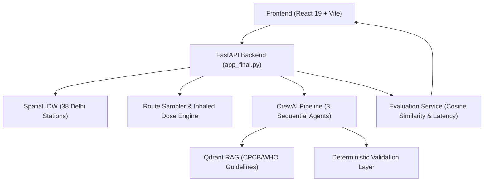

# AI-Powered Environmental Intelligence System (AirSense)

AirSense is an urban environmental intelligence and exposure-aware mobility recommendation platform engineered for the National Capital Territory (NCT) of Delhi. The system ingests ambient telemetry, computes spatial Inverse Distance Weighting (IDW) interpolation over 38 ground stations, and calculates inhaled pollutant exposure across candidate corridors. By combining time-series forecasting with a sequential multi-agent advisory pipeline, AirSense helps commuters identify cleaner, lower-risk travel routes.

---

## Key Features

* **Interactive Air-Quality Map & Search**: Leaflet map displaying 38 Delhi NCR monitoring stations with EPA color coding, paired with landmark and station autocomplete search (`/geocode/search`).
* **Spatial AQI Interpolation**: Coordinate-level air quality estimation using Inverse Distance Weighting (IDW) combined with microclimate weather telemetry.
* **Pollution-Aware Route Comparison**: Evaluates Cleanest, Balanced, and Fastest corridors, quantifying travel duration, average/peak AQI exposure, and estimated inhaled $\text{PM}_{2.5}$ dose ($\mu\text{g}$).
* **AirGuideBot Assistant**: Grounded chatbot providing commute advice, diurnal temperature inversion jogging windows, and CAQM GRAP stage vehicle regulations.
* **Three-Agent CrewAI Workflow**: Sequential multi-agent pipeline (Environmental Intelligence, Route & Risk Analysis, and AI Advisory) with a deterministic validation safeguard.
* **RAG Knowledge Retrieval**: Qdrant vector database indexing authoritative CPCB, WHO, IMD, and MoHFW guidelines via `sentence-transformers/all-MiniLM-L6-v2`.
* **Evaluation Transparency**: Real-time cosine similarity indicators (Question–Answer, Answer–Context, Retrieved-Context) and `time.perf_counter()` latency metrics in chat cards.

---

## Technology Stack

| Layer | Stack |
|---|---|
| **Frontend** | React 19, Vite v8, React Router v7, Leaflet, Recharts |
| **Backend API** | FastAPI, Uvicorn, Pydantic v2 |
| **Multi-Agent & LLM** | CrewAI, LiteLLM, Google Gemini (`gemini-3.1-flash-lite`) |
| **Vector DB & RAG** | Qdrant Client, SentenceTransformers (`all-MiniLM-L6-v2`) |
| **ML & Geospatial** | PyTorch / Keras LSTM, Scikit-Learn, NumPy, Pandas, Haversine IDW, OpenRouteService / OSRM |
| **Testing** | Pytest, FastAPI TestClient |

---

## System Architecture



---

## Project Structure

```text
├── airsense-frontend/          # React 19 + Vite web interface
├── backend/                    # FastAPI backend (app_final.py, crew_advisor.py, rag_service.py)
├── dataset/                    # Historical Delhi air quality data & documentation
├── docs/                       # Project documentation & architectural assets
├── notebooks/                  # EDA and model training notebooks
├── tests/                      # Automated test suite (pytest: evaluation, integration, unit)
├── start.bat                   # Unified startup script (FastAPI + React Vite)
├── stop.bat                    # Safe process shutdown script
├── Dockerfile                  # Container build specification (app_final)
├── MILESTONE1_REPORT.md        # Preserved Milestone 1 report
├── MILESTONE2_REPORT.md        # Preserved Milestone 2 report
└── LICENSE                     # MIT License
```

---

## Installation and Setup

### 1. Clone & Switch Branch
```bash
git clone https://github.com/Springboard-Internship-2026/AI-Powered-Environmental-Intellig-System-for-Air-Quality-Predic-and-Smart-Mobility-Recomme-AUG-2026.git
cd AI-Powered-Environmental-Intellig-System-for-Air-Quality-Predic-and-Smart-Mobility-Recomme-AUG-2026
git checkout abhishek-ainapure
```

### 2. Configure Backend
```bash
pip install -r backend/requirements.txt
cp backend/.env.example backend/.env
# Add GEMINI_API_KEY to backend/.env (free tier: https://aistudio.google.com/)
python -m uvicorn backend.app_final:app --host 127.0.0.1 --port 8000
```
Backend runs at `http://127.0.0.1:8000` (interactive documentation at `/docs`).

### 3. Run Frontend
```bash
cd airsense-frontend
npm install
npm run dev
```
Frontend runs at `http://localhost:5173`.

---

## AI Workflow & Evaluation

1. **Environmental Ingestion**: Telemetry from 38 Delhi ground monitors is spatially interpolated across arbitrary coordinates via IDW.
2. **Route Exposure Scoring**: Candidate road corridors are sampled to compute distance, duration, average/peak AQI, and estimated inhaled $\text{PM}_{2.5}$ dose.
3. **CrewAI Advisory**: The *Environmental Intelligence Agent* verifies atmospheric stability, the *Route & Risk Analysis Agent* evaluates speed versus exposure trade-offs, and the *AI Advisory Agent* consults Qdrant RAG knowledge to formulate personalized travel guidance. A *Deterministic Validation Layer* enforces bounds and prevents hallucinated recommendations.

### AirGuideBot Evaluation Indicators

AirGuideBot displays real-time evaluation indicators computed for live responses:

| Metric | Explanation |
|---|---|
| **Question–Answer Semantic Similarity** | Cosine similarity between the user's question embedding and the generated answer embedding. Measures semantic similarity, not factual correctness. |
| **Answer–Context Semantic Similarity** | Cosine similarity between the generated answer and retrieved RAG context. Displays `N/A` when suitable context is unavailable. |
| **Retrieved-Context Similarity** | The actual retrieval similarity score of the top Qdrant result, when available. |
| **Generation Latency** | Time taken to generate the response, measured using `time.perf_counter()`. |
| **End-to-End Latency** | Total processing time for the relevant request, measured separately from generation latency. |

> Semantic similarity indicates embedding-space proximity and does not establish factual correctness. Latency measurements describe execution time, not response quality.

### Formal RAGAS Benchmark Metrics

Formal RAGAS metrics are not evaluated for live responses and are returned as `N/A` by the backend:
* **Faithfulness**: Requires claim-level natural language inference (NLI) against retrieved context.
* **Answer Relevancy**: Requires reverse candidate question generation from the answer.
* **Context Precision**: Requires per-chunk ground-truth relevance annotations.
* **Context Recall**: Requires gold reference answers unavailable in interactive chat.

These metrics are evaluated separately in the offline benchmark suite (`backend/evaluation_service.py: evaluate_offline_rag_benchmark`) on test datasets with labeled reference ground truth.

---

## Testing

```bash
# Run backend test suite (21 unit, integration, and evaluation tests)
pytest

# Validate frontend production build
cd airsense-frontend && npm run build
```

---

## Limitations

* **Station Density**: IDW interpolation accuracy depends on sensor distribution; peripheral NCR regions have higher uncertainty than central urban clusters.
* **Interpolated vs. Point Data**: Estimates between stations represent continuous ambient spatial gradients rather than direct micro-sensor measurements.
* **External API Fallbacks**: Routing (ORS/OSRM) and weather (Open-Meteo) utilize cached offline fallbacks when external services experience rate limits.
* **Chat Evaluation Scope**: Live indicators reflect semantic similarity for low-latency responsiveness rather than full formal NLI claim verification.

---

## My Role & Contributions

**Role:** AI/ML Developer — Infosys Springboard Internship

* **Multi-Agent AI Integration**: Integrated the three-agent CrewAI advisory workflow (`backend/crew_advisor.py`) to orchestrate environmental intelligence, corridor risk analysis, and personalized health advisories, reinforced with a deterministic validation safeguard.
* **RAG Knowledge Subsystem**: Implemented the Qdrant vector retrieval engine (`backend/rag_service.py`) using `sentence-transformers/all-MiniLM-L6-v2` to ground advisories and chatbot answers in authoritative CPCB, WHO, and MoHFW guidelines.
* **Backend API Development**: Developed and consolidated FastAPI services (`backend/app_final.py`) for sequential route advisory (`/route_advisory`), place search autocomplete (`/geocode/search`), and AirGuideBot conversational assistance (`/airguide_chat`).
* **Frontend Dashboard & UI**: Contributed to the React 19 + Vite single-page application (`airsense-frontend/`), integrating landmark autocomplete, route exposure comparison cards, and the AirGuideBot modal interface.
* **Testing & Quality Evaluation**: Built the response evaluation service (`backend/evaluation_service.py`) implementing real-time cosine semantic similarity indicators and `time.perf_counter()` latency tracking, alongside authoring automated Pytest test suites (`tests/`).

---

## Internship, Author and License

* **Program**: Infosys Springboard Internship (AI-Powered Environmental Intelligence System for Air Quality Prediction and Smart Mobility Recommendations)
* **Milestone Continuity**: Preserves Milestone 1 EDA, Milestone 2 model deployment/Flask demonstration, Milestone 3 Flutter app, and foundational datasets alongside AirSense.
* **Author**: Abhishek Ainapure ([ainapureabhi0821@gmail.com](mailto:ainapureabhi0821@gmail.com))
* **License**: Licensed under the [MIT License](LICENSE).

